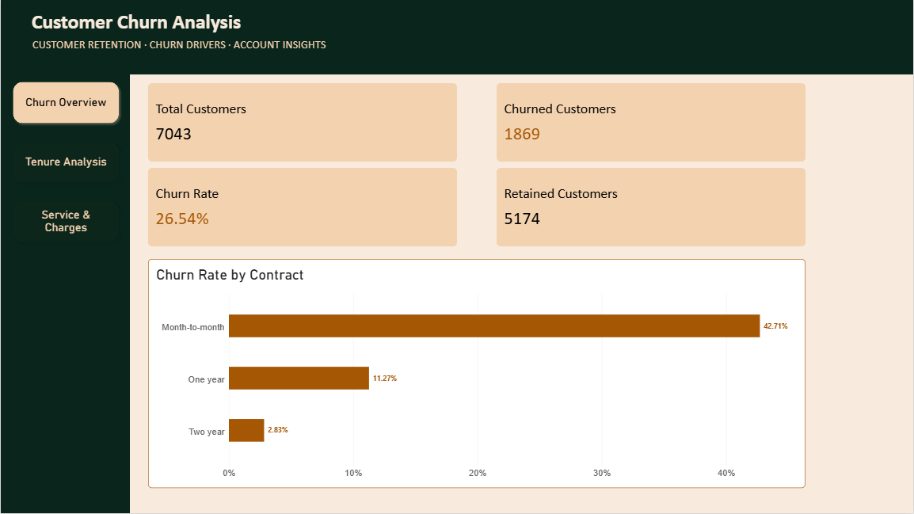
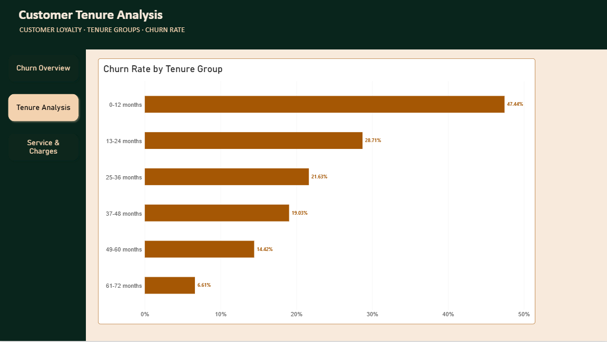
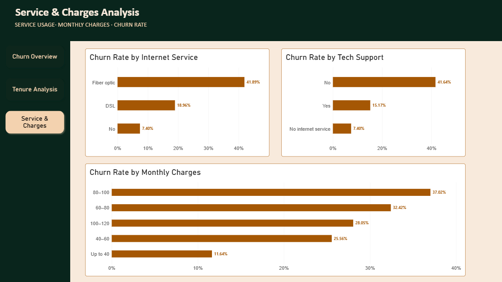

# Customer Churn Analysis

## Overview

This project uses Microsoft Power BI to analyze customer churn in a telecommunications dataset. The dashboard explores customer retention, contract types, tenure, internet services, technical support, and monthly charges.

The objective is to identify patterns associated with customer churn and communicate findings that may help inform customer retention strategies.

## Business Questions

1. **Overall Customer Churn:** How many customers churned, and what is the overall churn rate?
2. **Contract Analysis:** How does churn rate vary by contract type?
3. **Customer Tenure Analysis:** How does churn rate vary with customer tenure?
4. **Charges Analysis:** How do monthly charges relate to customer churn?
5. **Service Analysis:** How does churn rate vary by internet service and support options?

## Dashboard Preview

### 1. Churn Overview

This page presents the main customer KPIs and compares churn rates across contract types.

### 2. Tenure Analysis

This page compares churn rates across customer tenure groups.

### 3. Service & Charges Analysis

This page explores churn rates by internet service, technical support availability, and monthly charge ranges.

## Key Findings

- The dataset contains **7,043 customers**.
- **1,869 customers churned**, corresponding to an overall churn rate of approximately **26.54%**.
- **5,174 customers were retained** in the dataset.
- Month-to-month contracts have a churn rate of **42.71%**, compared with **11.27%** for one-year contracts and **2.83%** for two-year contracts.
- Churn rates are higher among customers in shorter tenure groups in the observed data. The 0–12 month group has a churn rate of **47.44%**, compared with **6.61%** for the 61–72 month group.
- Customers using fiber-optic internet have an observed churn rate of **41.89%**.
- The monthly charge range of 80–100 has an observed churn rate of **37.02%**, while the 60–80 range has a rate of **32.42%**.

These findings describe associations in the dataset. They do not prove that contract type, tenure, service type, or charges independently cause customer churn.

## Data Preparation and Validation

Data preparation and quality checks were performed using Power Query and Power BI.

- Reviewed customer identifiers and checked for duplicate IDs.
- Examined column quality, missing values, and data types.
- Confirmed that the records with blank `TotalCharges` values had `tenure = 0`.
- Replaced those blank `TotalCharges` values with zero while preserving all customer records.
- Validated key customer counts and the overall churn rate.

The replacement of blank `TotalCharges` values was based on the observed tenure pattern in this dataset. Missing values in other datasets should be investigated before applying similar treatment.

## Tools and Skills

- Microsoft Power BI
- Power Query
- DAX measures
- Data cleaning and quality assessment
- Customer churn and retention analysis
- Data visualization and dashboard design
- KPI calculation and validation
- Business insight communication

## Dataset

**Source:** [IBM Telco Customer Churn Dataset](https://github.com/IBM/telco-customer-churn-on-icp4d/blob/master/data/Telco-Customer-Churn.csv)

The dataset contains customer characteristics, subscribed services, contract details, charges, tenure, and churn status.

## Project File

- `Customer-Churn-Analysis.pbix` — Interactive Power BI report.

## How to Explore the Project

1. Download the `.pbix` file from this repository.
2. Open it using Power BI Desktop.
3. Navigate through the Churn Overview, Tenure Analysis, and Service & Charges Analysis pages.
4. Explore the visualizations and compare churn rates across customer groups.

## Limitations

The analysis is based on the fields available in the dataset. The dashboard identifies patterns and associations, but does not establish the causes of individual customer churn.
